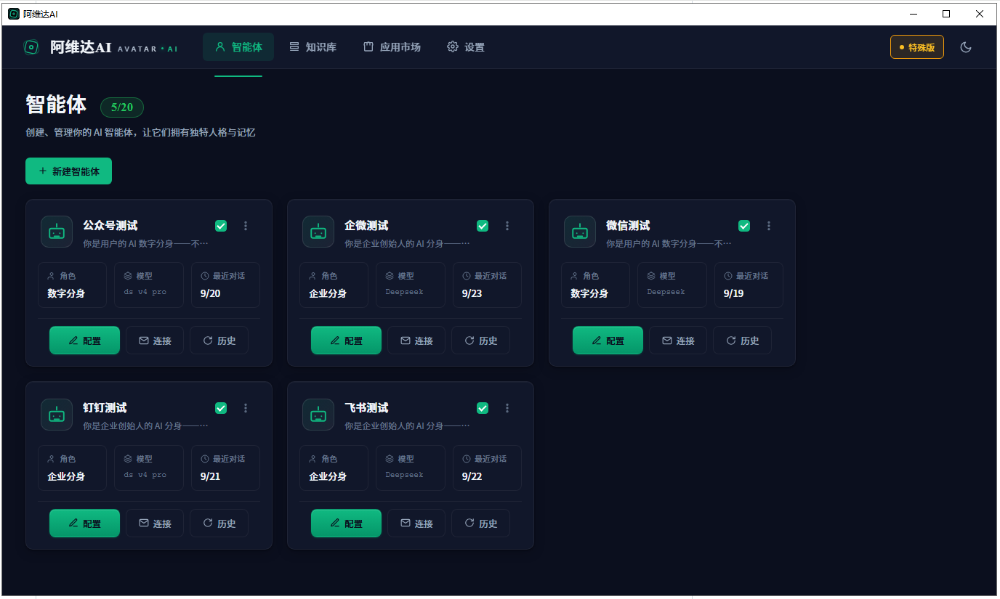

# Avatar AI · 你的 Personal AI 工作台

> Windows 桌面端可视化 Personal AI 工作台。
> 
> 可视化配置，知识库、记忆、对话历史全部本地化，智能体任意搭配多渠道消息。
> 
> **免费版可长期使用**（不是试用版）。


---

## 这是什么

Avatar AI 是一款**桌面端可视化 Personal AI 工作台**。

市面上的 AI 产品大多是网页、纯对话、云端托管——豆包、文心、WorkBuddy、Trae 都是这个路子。Avatar AI 不一样：

| | Avatar AI | 其他 AI 工具 |
|---|---|---|
| **形态** | Windows 桌面 EXE，双击即用 | 网页 SaaS / 浏览器插件 / IDE 插件 |
| **交互** | 可视化工作台：卡片、开关、拖拽、配置面板 | 对话框打字、prompt engineering |
| **智能体** | 一个人可以建很多个，每个一个角色、一套知识、一条消息通道 | 通常一个通用对话框，或者依赖平台预设 |
| **数据** | 知识、记忆、对话都在你自己电脑上（SQLite 本地存储） | 云端存储，你的数据属于平台 |
| **消息通道** | 真正对接公众号、企微、飞书、钉钉——AI 在这些渠道里替你干活 | 仅限 App 内对话 |

---

## 界面预览

智能体工作台 — 一屏看到你所有的数字分身，每个独立配置、独立跑在各自的消息渠道里：



---

## 核心卖点（别人没有的）

**① 桌面 EXE，不是网页 SaaS**
装在你自己电脑上，不占浏览器标签，不依赖网络，开机就能跑。数据主权在你手里。

**② 可视化图形化工作台**
对话只是底层能力。你看到的是卡片、是开关、是配置面板、是每个智能体的状态灯——像搭乐高一样搭你的 Personal AI。

**③ 多智能体 + 真实消息渠道**
一个人可以同时跑多个智能体：一个是你的企业分身，一个是你的 KOC 分身在公众号回粉丝，一个是销售顾问在飞书跟进线索。每个智能体独立跑在真实渠道里，7×24 值守。

## 应用场景

你说"我要一个数字分身"的时候，你可能想到的：

### 🎯 KOL / KOC 数字分身
把你历史视频的文案、公众号文章、直播回放的文字稿喂进去——它就是"你"。粉丝在公众号问同款、问链接、问价格，它替你回。

### 🏢 企业老板的组织内部管理
把公司制度、产品说明、会议纪要、老员工做过的方案灌进去——它就是"你的组织记忆"。新人来问流程、老员工来问历史方案，它直接给答案。

### 🛒 电商微商 × CPS 选品
好单库选品 → AI 自动生成种草文案 → 定时发到企微群 / 飞书群 / 朋友圈素材库。从选品到发内容一条链路，你只管审批。

### 📞 销售顾问的线索跟进
客户在企微加了你好友 → AI 自动打招呼 → 挖掘需求 → 跟进跟进再跟进 → 你只在需要的时候接电话。

### 🎓 老师 / 培训师的学习搭档
把教材、讲义、历年真题喂进去——你的专属 AI 助教。学生问问题它先答，答不出来转给你；学生没问它主动出一道题。

## 7 种角色（内置模板）

Avatar AI 预定义了 7 种角色模板，一键选用：

| 角色 | 场景 |
|---|---|
| 🎭 **数字分身** | 学你的语气、习惯、偏好，回复像你本人 |
| 💬 **专属客服** | 回答产品问题、处理售前咨询、引导下单 |
| 📞 **销售顾问** | 跟进线索、挖掘需求、异议处理、促成转化 |
| 📚 **学习搭档** | 上传教材/讲义，帮你答疑、出题、整理笔记 |
| 💝 **情感陪聊** | 温暖陪伴、情绪疏导、日常对话 |
| 🛒 **优惠推荐官** | 帮用户找优惠、比价、选品 |
| 🏢 **企业分身** | 企业内部知识问答、会议纪要、流程指引 |

## 核心功能

### 身份模拟
AI 学习你或团队的语气、习惯、偏好——回复不像机器人，像你本人。

### 知识增强
上传 Word / PDF / Markdown / TXT / Excel 等文档，自动切片入库。回答时检索+引用，有据可查。

### 记忆进化
从对话中自动提炼用户画像和偏好，每 24 小时整理一次，越用越懂人。

### 应用市场（v2.0 新增）
给智能体装「手」——选品导购、定时发消息、内容创作、多渠道转发等扩展能力。

### 多渠道对接
| 渠道 | 说明 |
|---|---|
| 微信公众号 | 官方消息 API |
| 企业微信 | 客户联系 / 会话存档 |
| 飞书 | IM / 文档 / 日历 |
| 钉钉 | IM / 审批 / 通讯录 |

### 本地优先
数据保存在你自己电脑上（SQLite），不经第三方服务器。云端只负责授权校验和应用市场索引。

## 快速开始

```text
1. 下载最新版：https://github.com/Barrylaiheng/avatar-ai/releases/latest
2. 双击 Avatar AI.exe 启动
3. 新建智能体 → 选角色模板 → 填人设 → 选语言模型
4. 上传资料建立知识库
5. 绑定沟通渠道（公众号 / 企微 / 飞书 / 钉钉）
6. 给智能体装上应用市场的扩展能力（可选）
7. 让它跑起来
```

## 关于本项目

**Avatar AI 是闭源商业软件**，核心代码不公开。本仓库仅提供产品介绍和 Release 下载入口。

- 最新下载：<https://github.com/Barrylaiheng/avatar-ai/releases/latest>
- 历史版本：<https://github.com/Barrylaiheng/avatar-ai/releases>
- Bug 反馈 / 功能建议：<https://github.com/Barrylaiheng/avatar-ai/issues>

## 常见问题

> **杀毒软件误判怎么办？**

本工具未购买代码签名证书（OV 证书约 ¥3000+/年，MVP 阶段暂缓），Windows Defender 或其他杀毒可能把未知 EXE 标记为风险。解决方法：从隔离区还原，或关闭实时防护后再启动。软件本身不联网（除云端授权校验 + 你绑定的渠道 API），不上传任何本地数据。

> **免费版和付费版有什么区别？**

免费版 2 个智能体、不能用知识库/记忆/应用市场，但能正常对接公众号、企微、飞书、钉钉。升级权益详情见 App 内「权益管理」页面。

> **要不要懂 prompt engineering？**

不需要。选角色模板后，系统自动给你一套合理的人设 + 开场白 + 输出风格。你只需要改改细节或直接开用。

## 反馈与联系

- GitHub Issues：<https://github.com/Barrylaiheng/avatar-ai/issues>
- QQ：3564096269
- 如果工具对你有帮助，请给个 ⭐

## Changelog

### v2.10.1（2026-10-19）
- 🆕 **AI 开发助手（MCP）**：支持 TRAE / Wo Buddy 等 AI 工具通过 MCP 协议对话式开发自定义应用——说一句"帮我注册一个好单库选品应用"即可完成，不用写代码
- ✅ 复制按钮跨浏览器修复（PyQt WebEngine 兜底）

### v2.10.0（2026-10-18）
- 🆕 **应用市场**：给智能体装扩展能力（选品、定时发送、内容创作等），支持 10+ 内置应用
- 🆕 **权益系统升级**：4 档 tier 完整权益门控（免费版 ↔ 入门版 ↔ 标准版 ↔ 专业版）
- 🆕 **应用 tab gate**：智能体配置 → 应用 tab 对齐知识库/记忆的付费锁模式
- ✅ 修复 gear 弹窗点遮罩意外关闭、按钮文字不居中
- ✅ 修复 appsToggleGate checkbox 不真正 toggle 的 bug
- ✅ tab 顺序：应用调到内容管理前
- ✅ MVP 打包 PyInstaller 完整适配（asyncio / 10 个应用 runner hidden-import 全覆盖）
- ✅ 另一台 Windows 纯环境真机验证通过

### v2.9.x 及更早
历史版本 changelog 见 GitHub Releases 页面。
